  

  
  
  

  

---

## ⚡ Recruiter mode

  

## 🧠 How I build GenAI

  

## 🚀 Featured projects

<table>
  <tr>
    <td width="50%"></td>
    <td width="50%"></td>
  </tr>
  <tr>
    <td width="50%"></td>
    <td width="50%" align="center"><b>🧪 More coming soon</b> single-agent vs. agent-team code generation and more GenAI experiments</td>
  </tr>
</table>

---

## 🛠️ Languages &amp; tools

  

---

## 📊 GitHub stats

  
  

  

---

## 🤝 Connect with me

  
  

I'm happy to talk about Werkstudent roles, research assistant positions or GenAI projects. ✨
